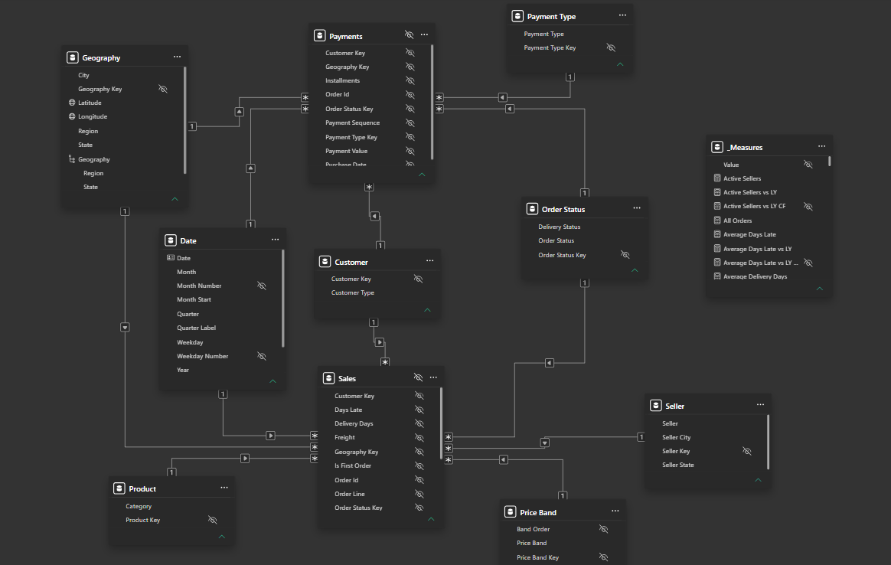
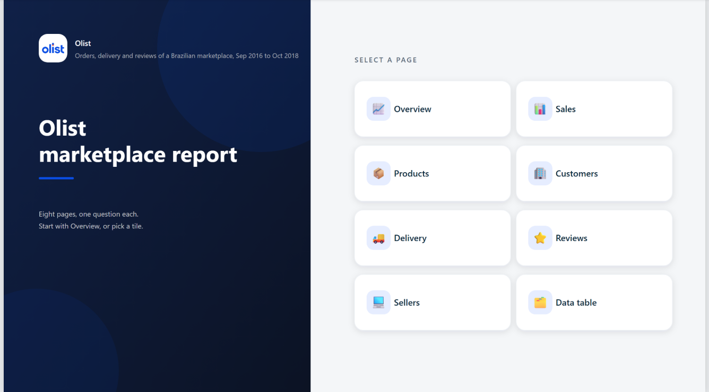
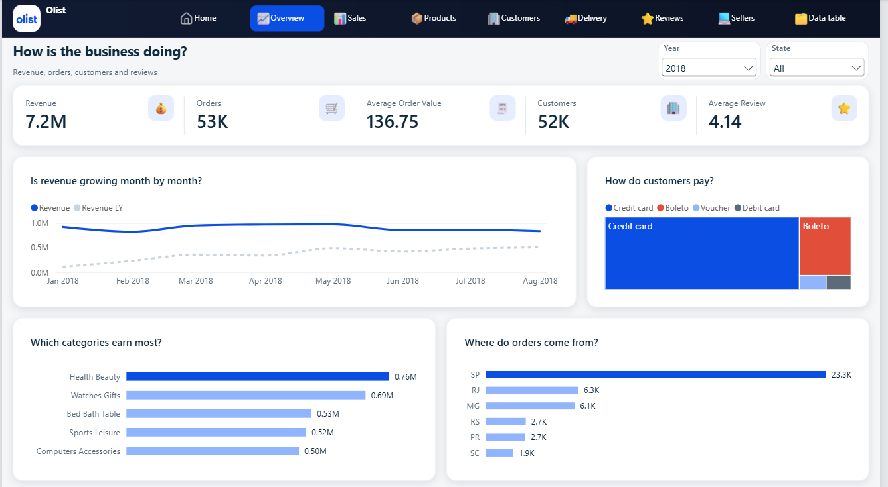
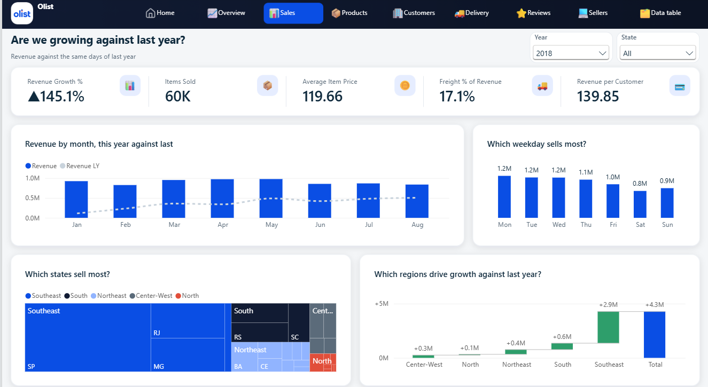
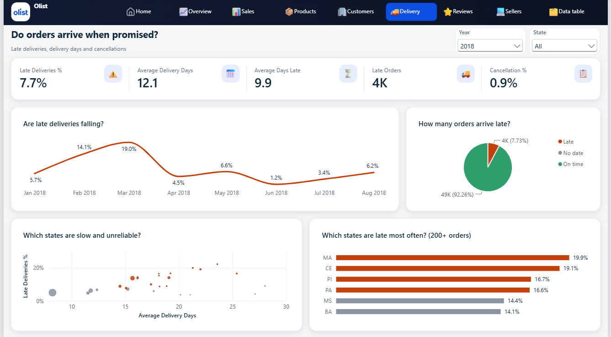
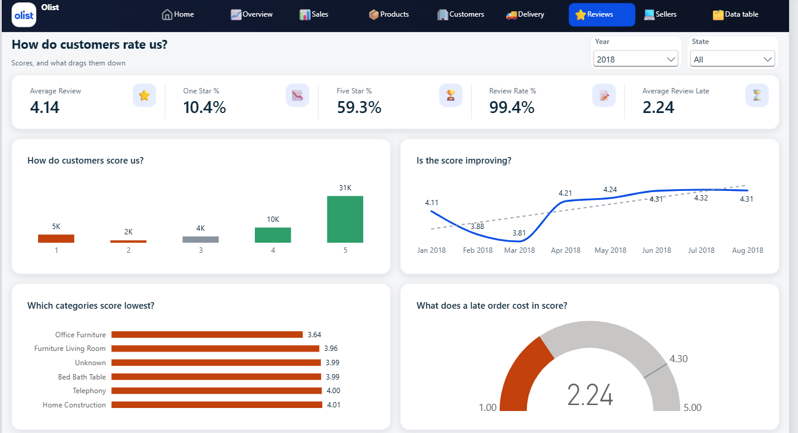
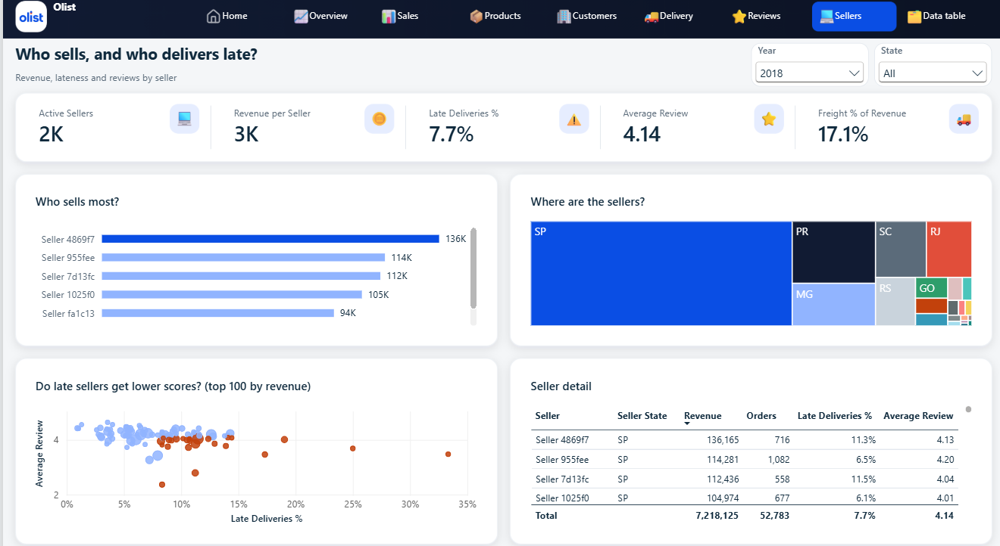

<p align="center">
  
</p>

<p align="center">
  
</p>

<p align="center">
  
  
  
</p>

<h3 align="center">96,478 orders: orders that arrived late scored 2.27 stars against 4.29 on time,<br>and the top 10% of sellers brought 67% of revenue.</h3>

A Power BI report that shows an online marketplace where late deliveries cost it reviews, which sellers cause it,
and how little of its growth comes from customers who return. It is the project to look at if your reports come
from separate exports and the totals never agree.

## The problem

An online marketplace sells through about three thousand independent sellers. Orders, items, payments, sellers,
customers and reviews come out as separate exports, so nobody can answer on one page:

- Are we growing against last year, and where?
- What sells, and who sells it?
- What do late deliveries cost us in customer reviews, and which sellers and states cause them?

Every report starts with a day of cleaning, and the totals never agree.

## 🛠️ The solution

One clean model, built once, that every page reads. Each fact meets the others only through shared dimensions, so
a number never changes depending on which page you are on:



1. **Collect and clean.** A Python script reads the nine input files, applies the business rules once and writes ten
   tables.
2. **Prove it.** The script recomputes 29 control totals (revenue, orders, late %, reviews, payments) from those
   tables and stops if one differs from the figure computed straight from the source files.
3. **Model.** Power BI reads the ten tables. 115 DAX measures sit in one table, each with a description.
4. **Report.** One question per page, a title that asks the question, and colour that means something: green is
   good, red is bad, the accent marks the leader.

## 📈 What the numbers say

| | |
|---|---|
| Revenue (delivered orders, Sep 2016 to Aug 2018) | 13,221,498 from 96,478 orders and 93,358 customers |
| Growth | 2018 revenue up **145.1%** on the same days of 2017 (7.22M against 2.94M) |
| Late deliveries | **6.8%** of delivered orders arrived after the estimated date (6,534 orders) |
| What late costs | late orders average **2.27** stars against **4.29** on time; **54%** of reviewed late orders get 1 star, against 7% of reviewed on-time orders |
| Seller concentration | the top 10% of sellers (297 of 2,970) bring **67.1%** of revenue |
| Category concentration | the top 10 of 73 named categories bring **62.4%** of revenue |
| Repeat buyers | only **3.0%** of customers ordered a second time |

What a manager does with it:

1. **Fix late deliveries first.** They are 6.8% of orders but more than half of them end in a 1-star review. The
   Delivery page shows which states are late most often and which are both slow and unreliable; the Sellers page
   shows who delivers late and gets rated lower.
2. **Look after the top 297 sellers.** Two thirds of revenue depends on them.
3. **Win the second order.** With 3% of customers coming back, almost all growth is paid for with new customers.

These are patterns in the data, not proven causes: the report shows where to look.

## 📊 The report

A cover with a tile for each page, then eight pages, one question each:

| Page | Question it answers |
|---|---|
| Overview | How is the business doing? |
| Sales | Are we growing against last year, and where? |
| Products | What sells? |
| Customers | Who buys, and do they come back? |
| Delivery | Do orders arrive when promised? |
| Reviews | How do customers rate us, and what drags the score down? |
| Sellers | Who sells, and who delivers late? |
| Data table | Can I take the numbers to Excel? |

Year and State slicers are synced on every page.

### 📸 Screenshots



**Overview:** revenue, orders, customers and reviews at a glance, with how customers pay.



**Sales:** this year against last by month, and which regions drive the growth.



**Delivery:** late deliveries by month, and the states that are both slow and unreliable.



**Reviews:** how scores split, and what a late order costs in score.



**Sellers:** who sells most, and who is later and rated lower than the rest.



More: [Products](docs/screenshots/03-products.png), [Customers](docs/screenshots/04-customers.png),
[Data table](docs/screenshots/08-data-table.png).

## 🔍 How the numbers are checked

- [`olist-report/pipeline/expected_numbers.py`](olist-report/pipeline/expected_numbers.py) computes the 29 control
  totals in pandas straight from the input files, independently of the model.
- [`olist-report/pipeline/build_star.py`](olist-report/pipeline/build_star.py) rebuilds each measure from the model
  tables the way the DAX defines it and stops if one differs.
- [`olist-report/powerbi/verify-measures.dax`](olist-report/powerbi/verify-measures.dax) is one query that returns
  the same totals from the DAX measures in Power BI Desktop, to compare with
  [`control-totals.md`](olist-report/powerbi/control-totals.md).

Rules (written once, in `build_star.py`): a sale is an item of a delivered order; revenue is the item price, with
freight shown on its own; an order is late when it arrives after the estimated date (dates only); each order keeps
its latest review; a repeat customer is a person with a second delivered order.

## ▶️ Run it

```bash
pip install pandas numpy
```

Put the nine input files in one folder (see "Data" below), build the tables and check the totals:

```bash
python olist-report/pipeline/build_star.py "<folder with the input files>"
```

Open [`olist-report/olist_e_commerce_report.pbip`](olist-report/powerbi/README.md) in Power BI Desktop, set the
`Data Folder` parameter to `olist-report/data` if the path differs, click **Refresh now**, then run
`olist-report/powerbi/verify-measures.dax`.

```
olist-report/pipeline/       build_star.py (tables + checks), build_model.py (TMDL), build_pages.py (visuals), measures.py
olist-report/powerbi/        brief, page plan, design brief, model notes, checks, hand-over README, theme
olist-report/                the Power BI project: model (TMDL) and report (PBIR)
docs/screenshots/            the report pages and the model view
analysis/, config/, powerbi/ the first build of this project (notebook and build pack), kept for reference
```

## 🏗️ For engineers

| Step | What happens | Where |
|---|---|---|
| Input | Nine files as received, only read | `data/input/` and your folder |
| Clean and model | Typed, keyed, one row per order line plus one row for each order with no line; joins are left joins; keys are checked | `build_star.py` |
| Prove | 29 control totals against the source | `build_star.py`, `expected_numbers.py` |
| Semantic | Ten tables in TMDL: two facts, eight dimensions, twelve one-to-many single-direction relationships | `build_model.py` |
| Analytical | 115 measures, every one described, in display folders | `measures.py` |
| Report | Nine pages written as PBIR, drawn backgrounds from the powerbi-kit frames script | `build_pages.py` |

The decisions that matter:

| Decision | Why |
|---|---|
| The fact is at order-line grain; the order header only gives context | an order with several lines would otherwise count once per line, or twice when facts are joined through the header |
| Sales and Payments never relate to each other | they meet only through shared dimensions, so no number depends on a join path |
| Order-level values (review, delivery days) repeat on each line | measures count distinct orders and average over distinct orders |
| State lives on Geography, not on Customer | 39 people ordered from more than one state |
| Delivery status and order status share one small dimension | one key instead of several flags on the fact |
| Reviewed orders keep the axis filter (`KEEPFILTERS`) | a plain filter on the score column replaced the chart's own score and showed the total for every score |

## 🗂️ Data

The [Brazilian E-Commerce Public Dataset by Olist](https://www.kaggle.com/datasets/olistbr/brazilian-ecommerce)
on Kaggle: about 100,000 orders placed on the Olist marketplace from 2016 to 2018, licensed CC BY-NC-SA 4.0.
Amounts are in Brazilian reais. All nine files are used (orders, order items, payments, reviews, customers,
products, sellers, category names, geolocation); the data has no product cost, so the report shows revenue and
freight but no margin.
